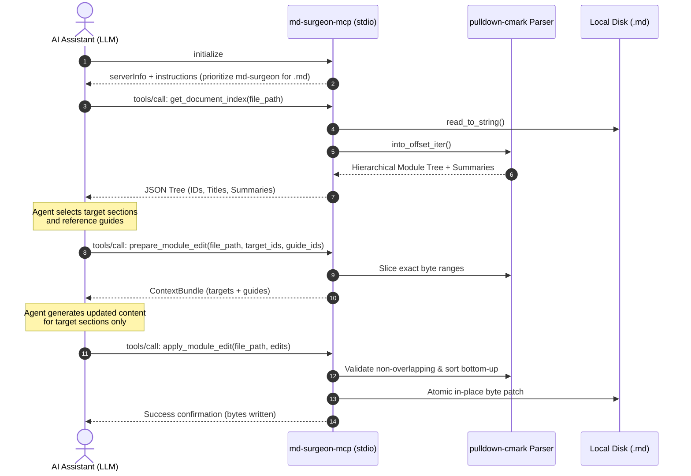

# md-surgeon-mcp

[](https://www.rust-lang.org/)
[](https://modelcontextprotocol.io/)
[](https://opensource.org/licenses/MIT)
[]()

**High-performance Model Context Protocol (MCP) server written in Rust for surgical, byte-accurate navigation and batch editing of large Markdown (`.md`) planning, design, and architecture documents.**

---

## The Problem: Context Blowout & Destructive Rewrites

When AI coding assistants (Claude Desktop, Cursor, Antigravity, Cline, Windsurf) interact with large planning documents (`PROJECT.md`, `ARCHITECTURE.md`, `SPEC.md`):

1. **Massive Token Waste**: Reading a 3,000-line Markdown file consumes 15,000+ tokens on every turn just to check a single data structure or enum.
2. **Context Window Degradation**: Large reads push valuable code history, compiler errors, and instructions out of the LLM context window.
3. **Accidental Deletions**: Rewriting full files with tools like `edit_file` or `write_file` frequently corrupts unrelated sections, destroys comments, or truncates content.

```
Traditional Approach:
[LLM] ──(read_file 100KB)──► [Full Context Loaded] ──(rewrite 100KB)──► [High Risk of Truncation]

md-surgeon-mcp Approach:
[LLM] ──(get_document_index)──► [Lightweight Tree & Summaries (~500 tokens)]
[LLM] ──(prepare_module_edit)──► [Only Target & Guide Sections (~1,000 tokens)]
[LLM] ──(apply_module_edit)────► [Surgical In-Place Byte-Range Patch (0% Collateral Damage)]
```

---

## Features

- **Ultra-Fast & Zero Runtime Dependencies**: Pure Rust with `pulldown-cmark` byte offsets (`into_offset_iter`). Runs in microseconds with zero heavy runtimes or bloat.
- **Hierarchical Semantic Tree**: Automatically indexes `#`, `##`, and `###` headers, assigning collision-free composite IDs (`parent/child`, e.g., `2-database/payments-table`).
- **Zero-Token Automatic Summaries**: Extracts the first sentence or paragraph/blockquote (max 120 chars) under each header, giving the AI full semantic navigation without returning token-heavy bodies.
- **Atomic Bottom-Up Batch Patching**: Resolves byte ranges, checks for overlapping conflicts, and applies multiple edits sorted from bottom to top so superior offsets are never invalidated.
- **Clean Deletions**: Setting `new_markdown_content: ""` removes the target module/submodule cleanly without leaving triple blank lines or orphaned headers.
- **Read-Only Guide Bundles**: Agents can pass `guide_ids` to load architectural contracts as reference while writing code in Rust, Python, Go, or GDScript without modifying the Markdown file.
- **Native MCP Zero-Config Steering**: Embeds protocol-level `instructions` in the `initialize` handshake and persuasive tool annotations (`readOnlyHint`, `idempotentHint`), steering AI agents automatically without requiring custom `.antigravityrules` or system prompt engineering.

---

## Architecture & Workflow



---

## Token Efficiency Benchmark

| Action | Traditional `read_file` / `edit_file` | `md-surgeon-mcp` | Token Savings |
| :--- | :---: | :---: | :---: |
| **Inspect Document Index** | ~18,500 tokens | **~650 tokens** | **~96%** |
| **Reference Architecture Section** | ~18,500 tokens | **~850 tokens** | **~95%** |
| **Update 3 Submodules (Batch)** | ~37,000 tokens (read + rewrite) | **~2,100 tokens** | **~94%** |
| **Risk of Collateral Truncation** | High (Entire file rewritten) | **0% (Byte-range targeted)** | **Guaranteed** |

---

## MCP Tools Reference

### 1. `get_document_index`
*Returns the semantic hierarchical tree of modules (`#`, `##`) and submodules (`###`) with automatic summaries.*
- **Annotations**: `readOnlyHint: true`, `destructiveHint: false`
- **Arguments**:
  - `file_path` (string, required): Path to the Markdown file.

### 2. `prepare_module_edit`
*Fetches current content of targets for editing and reference guides for read-only context in a single call.*
- **Annotations**: `readOnlyHint: true`, `destructiveHint: false`
- **Arguments**:
  - `file_path` (string, required): Path to the Markdown file.
  - `target_ids` (array of strings, optional): List of module or submodule IDs to edit.
  - `target_id` (string, optional): Single ID (backward compatibility).
  - `guide_ids` (array of strings, optional): List of module IDs to retrieve as read-only reference.

### 3. `apply_module_edit`
*Applies surgical byte-range replacements or deletions in bottom-up order, leaving untouched sections pristine.*
- **Annotations**: `readOnlyHint: false`, `destructiveHint: false`, `idempotentHint: true`
- **Arguments**:
  - `file_path` (string, required): Path to the Markdown file.
  - `edits` (array of objects, optional): `[ { "target_id": "...", "new_markdown_content": "..." } ]`. Pass `""` to delete.
  - `target_id` & `new_markdown_content` (string, optional): Single edit (backward compatibility).

---

## Installation & Setup

### Option 1: Install with Cargo from Git

```bash
cargo install --git https://github.com/LoP-1/md-surgeon-mcp
```

### Option 2: Build from Source

```bash
git clone https://github.com/LoP-1/md-surgeon-mcp.git
cd md-surgeon-mcp
cargo build --release
```
The optimized binary will be available at `./target/release/md-surgeon-mcp` (or `.exe` on Windows).

---

## Client Configuration

Add `md-surgeon-mcp` to your favorite MCP client configuration file:

### Claude Desktop
Edit `%APPDATA%\Claude\claude_desktop_config.json` (Windows) or `~/Library/Application Support/Claude/claude_desktop_config.json` (macOS):

```json
{
  "mcpServers": {
    "md-surgeon": {
      "command": "md-surgeon-mcp",
      "args": []
    }
  }
}
```

### Antigravity / Cursor / Windsurf / Cline
In your workspace `.gemini/antigravity/mcp_config.json` or global MCP settings:

```json
{
  "mcpServers": {
    "md-surgeon": {
      "command": "C:/path/to/target/release/md-surgeon-mcp.exe",
      "args": []
    }
  }
}
```

---

## Testing

Run the test suite including hierarchical indexing, summary truncation, bottom-up batch replacements, and JSON-RPC stdio flow:

```bash
cargo test
```

---

## License

This project is open-sourced under the [MIT License](LICENSE).
